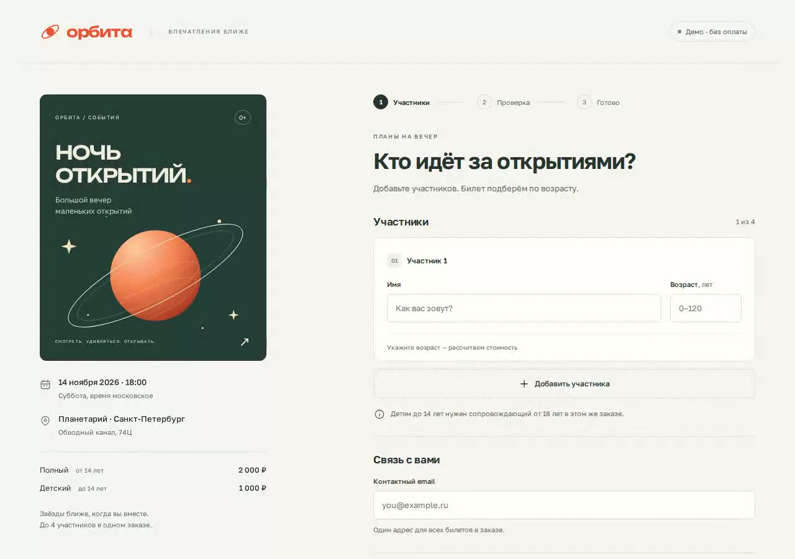

# Оформление билетов

Экран покупки билетов на вымышленное мероприятие «Ночь открытий». Можно добавить участников, увидеть стоимость, поправить данные и подтвердить заказ.

Деньги не списываются. Письма и входные билеты не отправляются.

## Посмотреть без установки

[Видео на 44 секунды](demo/sqoch-demo.mp4): оформление, правка заказа, сообщение «места закончились» и узкий экран. Если плеер на сайте не открылся, скачайте файл.

[](demo/sqoch-demo.mp4)

[Запись работы, 2 минуты 42 секунды, ускорение в 6 раз](demo/sqoch-process-6x.mp4). В кадре 16 минут 14 секунд. Разбор задания и часть создания проекта в запись не попали.

## Как запустить

Нужны Node.js 22.12 или новее и npm.

Скачайте архив: на странице репозитория кнопка **Code**, пункт **Download ZIP**. Распакуйте его. Если удобнее через git:

```bash
git clone https://github.com/GlebKostousov/sqoch-tickets.git
```

Откройте папку, в которой лежит `package.json`, и в терминале выполните:

```bash
npm ci
npm run dev
```

Первая команда ставит зависимости, вторая запускает экран. Откройте адрес из терминала, обычно http://localhost:5173. Терминал оставьте открытым. Остановка — `Ctrl+C`.

## Как проверить

Имена и почта любые, например Анна и `anna@example.com`.

Внизу страницы откройте **«Демо-сценарии»**.

**Успешный заказ.** Заполните участников и email, нажмите **«Проверить заказ»**, затем **«Подтвердить заказ»**. Откроется экран «Билеты ваши!».

**Места заканчиваются.** Сначала заполните форму и дойдите до проверки. Сообщение появится после **«Подтвердить заказ»**. Кнопка **«Вернуться к участникам»** отдаёт те же данные.

Имеет смысл пробовать ещё так:

- ребёнок младше 14 лет без человека от 18 лет в том же заказе — форма объясняет, кого не хватает, и дальше не пускает;
- участнику 14–17 лет билет оформляется, ребёнка он не сопровождает;
- на шаге проверки **«Изменить данные»** возвращает к форме, сумма считается заново;
- пятого участника добавить нельзя;
- окно шириной около 360 пикселей листается вниз, вбок страница не разъезжается.

В одном заказе от одного до четырёх участников. У каждого имя и возраст. Email один на заказ. До 14 лет билет стоит 1 000 ₽, с 14 лет — 2 000 ₽.

## Время и что осталось за кадром

На первую версию, проверки и материалы ушло около 30 минут. Таймера с первой минуты не было.

После обновления страницы введённое пропадает: имена и почту браузер не запоминает, сервера у демонстрации нет. Оплата, письма и настоящие места не подключены. Узкий экран проверялся в окне браузера, не на телефоне. Safari отдельно не проверялся.

## Автоматические проверки

```bash
npm run verify
npx playwright install chromium
npm run test:e2e
```

Первая команда проверяет типы, оформление, правила заказа и сборку. Дальше сценарии проходят в браузере на обычной ширине и на 360 пикселях.

Как приняты решения: [docs/decisions.md](docs/decisions.md). Сохранённые отчёты: [docs/verification.txt](docs/verification.txt), [docs/browser-verification.txt](docs/browser-verification.txt).

Шрифты Golos Text и Unbounded стоят в проекте локально. Тексты их лицензии OFL лежат в папке [licenses](licenses).
